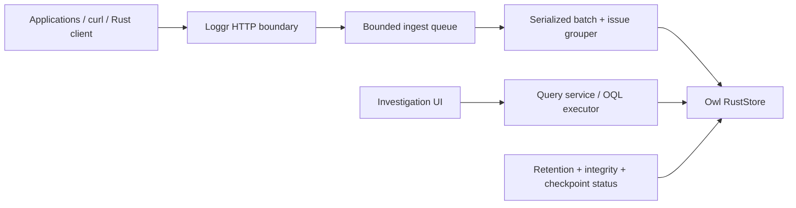

# Loggr Product and Architecture

Status: accepted initial direction  
Scope: the smallest useful application that proves Owl under a real workload

## 1. Product definition

Loggr is a local-first error investigation workbench for developers. Applications
send structured logs and stack traces to one Loggr process. When something
breaks, a developer opens Loggr, narrows the event stream, sees repeated failures
grouped into an issue, and reaches the relevant stack frame and surrounding logs
without leaving the investigation.

The defining loop is:

```text
send events -> notice a failure -> isolate an issue -> inspect one occurrence
            -> follow its trace/context -> fix the application
```

Loggr is not initially:

- a distributed observability platform
- a metrics or infrastructure-monitoring product
- an alert-routing and on-call system
- a multi-tenant hosted service
- a replacement for a general data explorer
- a reason to make Owl logging-specific

It is a small Rust application and Owl's first external forcing workload.

## 2. The first-run experience

The complete useful setup should fit in five minutes:

1. Run `loggr serve --db ./loggr.owl`.
2. Loggr prints its local URL and an ingest example.
3. Send one event with `curl`, NDJSON, or the Rust client.
4. Open `http://127.0.0.1:4310`.
5. See the event immediately, open it, and inspect its stack trace.

The default bind address is loopback. A fresh database creates its schemas and
indexes automatically. There is no mandatory account, organization, project,
dashboard, or onboarding wizard.

The initial command surface is deliberately small:

```text
loggr serve [--db PATH] [--bind ADDRESS] [--retention DAYS]
loggr send --file events.ndjson [--url URL]
loggr demo [--count N]
loggr check --db PATH
```

`loggr demo` generates a coherent sample incident, including normal request logs,
an exception, repeated occurrences, a trace ID, release metadata, and stack
frames. It is both onboarding and a repeatable Owl demonstration.

## 3. Core product experience

### 3.1 One investigation workspace

Loggr has one primary screen rather than a dashboard plus several disconnected
tools:

```text
┌──────────────────────────────────────────────────────────────────────────────┐
│ loggr  checkout-api / production      [last 30m]   [query…]   live ●        │
├───────────────┬────────────────────────────────────┬─────────────────────────┤
│ INVESTIGATE   │ EVENT STREAM                       │ OCCURRENCE              │
│               │                                    │                         │
│ All events    │ 12:41:08  ERROR  Payment failed    │ PaymentFailed           │
│ Errors        │ 12:41:07  WARN   retrying charge   │ checkout · prod · v81   │
│ Issues        │ 12:41:07  INFO   POST /checkout    │                         │
│               │ 12:40:59  ERROR  Payment failed    │ │ charge_order          │
│ Saved views   │                                    │ │ payments.rs:184       │
│ ───────────   │                                    │ │ gateway.charge        │
│ by service    │                                    │ │ stripe.rs:72          │
│ by release    │                                    │                         │
│ by level      │                                    │ Trace 7e41… · 9 events  │
└───────────────┴────────────────────────────────────┴─────────────────────────┘
```

The center stream is the focal element. Selecting a row opens the occurrence in
the right pane without losing scroll position or filters. A shareable URL stores
the selected event and investigation query.

### 3.2 Three views, one mental model

The navigation has only three primary modes:

- **All events** — the ordered raw event stream.
- **Errors** — the same stream with error/fatal levels selected.
- **Issues** — fingerprints ordered by most recent occurrence.

These are views over the same data, not separate products. Services,
environments, releases, levels, fingerprints, and trace IDs are filters or
links, not permanent navigation sections.

### 3.3 Querying

The query bar has two layers:

- The normal layer contains service, environment, level, time, fingerprint, and
  text controls. Every control visibly composes one investigation.
- `⌘/Ctrl + K` expands the same bar into OQL. The generated OQL remains visible
  and editable, so the friendly interface teaches Owl rather than hiding it.

Example generated query:

```oql
events
    .where {
        .application == "checkout-api" &&
        .environment == "production" &&
        .level_rank >= 40 &&
        .occurred_at >= "2026-07-23T10:00:00Z"
    }
    .sort { .occurred_at desc }
    .select {
        id,
        occurred_at,
        level,
        message,
        fingerprint,
        trace_id,
        release
    }
    .limit 200
```

The result header reports the chosen access path and elapsed time in a quiet
diagnostic line. This makes Owl's typed composite-index behavior observable
without turning the interface into a database administration tool.

### 3.4 Event detail

An occurrence pane contains, in order:

1. level, message, timestamp, application, environment, and release
2. issue fingerprint and occurrence count
3. the stack-trace execution spine
4. trace-correlated events, ordered around the selected timestamp
5. structured attributes
6. raw event JSON and stable event ID

The execution spine is Loggr's signature component. Stack frames form a strong
vertical line. Application frames are prominent; dependency and runtime frames
are collapsed into quieter groups. Clicking a frame copies `file:line`, and the
first application frame is selected by default. Repeated occurrences retain the
same visual spine so a developer can compare releases quickly.

### 3.5 Issue detail

An issue is a mutable summary around a stable fingerprint:

- current status: unresolved or resolved
- first and last seen
- total occurrence count
- affected releases and environments
- representative occurrence
- latest occurrences

Resolving an issue does not hide a later regression. A new occurrence after the
resolved timestamp changes the status back to `regressed` while preserving the
history.

## 4. Visual direction

### 4.1 Intent

- **Human:** a developer who has just seen an exception, a failed request, or a
  support report and needs evidence quickly.
- **Task:** move from a noisy stream to the exact failing execution frame.
- **Feel:** a quiet, precise debugging instrument—dense like a good terminal,
  but calmer and more legible than raw logs.

### 4.2 Domain exploration

- **Domain:** occurrences, fingerprints, execution frames, traces, releases,
  severity, causality, and time windows.
- **Color world:** graphite editor chrome, off-white source text, muted steel
  metadata, phosphor-green live state, amber warnings, ember-red failures, and
  violet trace links.
- **Signature:** the stack-trace execution spine, reused in occurrence detail,
  issue samples, trace context, comparison, and empty/demo states.
- **Rejected defaults:** metric-card dashboards, a rainbow severity palette,
  and a large icon sidebar. Loggr begins with evidence, uses color only for
  meaning, and keeps navigation subordinate to the event stream.

### 4.3 Interface system

The initial interface is dark-first because stack traces and logs are usually
read beside editors and terminals. Light mode may follow, but the tokens must be
semantic from the beginning.

```text
canvas          #0b0d10   graphite black
work surface    #111419   raised investigation surface
inset control   #080a0d   query and filter input
primary ink     #eef1f5   messages and source
secondary ink   #a7afb9   metadata
muted ink       #68717d   timestamps and collapsed frames
live            #58c792   connected/following state
warning         #d9a441   warn level
failure         #e4655f   error/fatal level
trace           #9b8cff   trace and reference links
```

Depth uses surface shifts and low-contrast borders, not card shadows. The base
spacing unit is 4 px. Stream rows are 36–44 px depending on wrapping; controls
are 32 px high; panels use 12–16 px padding. Interface text uses a neutral UI
sans; messages, OQL, identifiers, and stack frames use a readable monospace.
Severity is expressed by one narrow marker plus text—not a filled badge on every
row.

Responsive behavior is secondary but intentional. Below 900 px the occurrence
pane becomes a full-width layer over the stream; filters become a drawer. The
event stream remains the landing view.

## 5. Logical data model

The first version uses two primary collections. Stack frames and attributes are
embedded because they are read with their event and are not independently
mutable.

### 5.1 `events` — append-oriented

| Field | Owl value | Required | Purpose |
|---|---|---:|---|
| `id` | document ID/string | yes | caller ID or generated UUID |
| `application` | string | yes | service/application name |
| `environment` | string | yes | production, staging, local |
| `occurred_at` | datetime | yes | source event time |
| `received_at` | datetime | yes | Loggr ingest time |
| `level` | string | yes | trace, debug, info, warn, error, fatal |
| `level_rank` | integer | yes | 10, 20, 30, 40, 50, 60 |
| `kind` | string | yes | log or exception |
| `message` | string | yes | human-readable event message |
| `exception_type` | string/null | no | language/runtime error type |
| `fingerprint` | string/null | no | versioned normalized issue key |
| `trace_id` | string/null | no | request/distributed trace correlation |
| `span_id` | string/null | no | local span correlation |
| `release` | string/null | no | build, commit, or release identifier |
| `stack` | list<object> | no | ordered stack frames |
| `attributes` | object | no | bounded structured context |

A stack frame contains `module`, `function`, `file`, `line`, `column`, and
`in_app`. The ingest boundary limits frame count and string sizes.

### 5.2 `issues` — mutable

| Field | Owl value | Required | Purpose |
|---|---|---:|---|
| `id` | document ID/string | yes | fingerprint |
| `application` | string | yes | issue scope |
| `environment` | string | yes | issue scope |
| `fingerprint` | string | yes | normalized grouping key |
| `exception_type` | string/null | no | primary exception type |
| `title` | string | yes | stable issue title |
| `status` | string | yes | unresolved, resolved, regressed |
| `first_seen` | datetime | yes | first occurrence |
| `last_seen` | datetime | yes | newest occurrence |
| `occurrences` | integer | yes | durable occurrence count |
| `resolved_at` | datetime/null | no | latest manual resolution |
| `sample_event_id` | string | yes | representative occurrence ID |
| `latest_event_id` | string | yes | most recent occurrence ID |
| `first_release` | string/null | no | release first observed |
| `last_release` | string/null | no | release most recently observed |

Application and environment remain typed scalar fields in v0 rather than their
own collections. This keeps ingestion and navigation simple. They can become
referenced configuration objects only when the product needs metadata attached
to them.

Events and issues link atomically through the indexed fingerprint; issues retain
sample/latest event IDs for direct point reads. They do not use `ObjRef` fields
in v0 because a new issue and its first event are allocated inside the same
external batch, before either physical identity is visible to Loggr. A future
Owl batch API may bind logical IDs to references during planning; Loggr must not
reach into allocator internals to imitate that capability.

### 5.3 Fingerprinting

Fingerprinting is deterministic and versioned. The default input is:

```text
fingerprint-v1(application, environment, exception_type,
               normalized_message, first_three_in_app_frames)
```

Normalization removes volatile numbers, UUIDs, addresses, and generated path
segments without erasing meaningful words. The canonical bytes and algorithm
version are hashed. A caller-supplied fingerprint may override the default.
Changing the algorithm creates a new explicit version; historical fingerprints
are never silently reinterpreted.

### 5.4 Initial indexes

The initial indexes intentionally match investigation paths:

```text
events_by_application_time
  (application, environment, occurred_at, id)

events_by_level_time
  (application, environment, level_rank, occurred_at, id)

events_by_fingerprint_time
  (application, environment, fingerprint, occurred_at, id)

events_by_trace_time
  (trace_id, occurred_at, id)

issues_by_status_activity
  (application, environment, status, last_seen, id)

issues_by_fingerprint [unique]
  (application, environment, fingerprint)
```

Descending UI scans use the same ordered keys with a descending cursor; time is
not duplicated in a second reversed encoding.

## 6. Ingestion contract

The write API accepts one event or a bounded batch:

```text
POST /api/v1/events
POST /api/v1/events/batch
Content-Type: application/json | application/x-ndjson
```

An accepted response means Owl has durably committed the event. Loggr never
acknowledges merely queued data.

The ingest pipeline is:

```text
HTTP decode
  -> size/type validation
  -> timestamp and level normalization
  -> versioned fingerprint
  -> bounded writer queue
  -> serialized issue read/update
  -> one atomic Owl batch: issue + event(s)
  -> durable acknowledgement
```

The queue batches up to 256 events or 5 ms, whichever comes first. These are
starting values to benchmark, not permanent constants. Queue capacity is
bounded. Saturation returns `429` with `Retry-After`; invalid events return
`400`; an Owl durability failure returns `503` and is never reported as success.

The request limits are explicit:

- 1 MiB per event
- 8 MiB per batch
- 256 events per batch
- 256 stack frames per event
- 256 attributes and bounded nesting depth
- timestamps no more than 24 hours in the future

Event IDs make retry idempotency observable. Repeating an already committed ID
returns the original ID with `duplicate: true`; it does not increment an issue.

## 7. Process architecture

Loggr starts as one process and one Owl database:



One process preserves Owl's single-node guarantees and makes failures easy to
reason about. The HTTP runtime may be asynchronous, but all synchronous Owl
operations run outside async executor workers. The ingest writer owns ordering,
issue read-modify-write, batching, and backpressure.

The application should live as a separate consumer crate:

```text
apps/loggr/
  Cargo.toml
  src/
    main.rs          command parsing and lifecycle
    config.rs        validated configuration
    model.rs         API and domain types
    fingerprint.rs   deterministic normalization
    ingest.rs        queue, batching, idempotency, issue updates
    query.rs         filter-to-OQL and result shaping
    retention.rs     bounded maintenance policy
    web.rs           routes and embedded static assets
    bootstrap.rs     Owl schemas and indexes
  web/
    index.html
    app.js
    loggr.css
```

Keeping Loggr outside `owl_db`'s library modules is important: it proves that
Owl's public Rust API is sufficient and prevents the demo from reaching into
storage internals. The first UI is server-hosted HTML/CSS with a small amount of
framework-free JavaScript. A separate frontend toolchain or WASM client is not
required to prove the database.

## 8. Read architecture

Friendly filters compile into OQL and use `QueryExecutor`. Detail reads use the
stable event ID. Trace context uses `events_by_trace_time`; issue occurrence
lists use `events_by_fingerprint_time`. Every list uses keyset cursors rather
than offset pagination.

The UI never requests unbounded event scans. Default limits are 200 stream rows,
50 issue rows, 100 issue occurrences, and 200 trace events. Projection excludes
stack frames and attributes from stream rows; those fields are decoded only for
the selected event. This directly exercises Owl's projection-aware record path.

The first text search is intentionally modest: case-insensitive matching within
the already bounded/indexed time and service result set. General full-text
postings are an Owl/Loggr milestone, not something hidden behind an accidental
full database scan.

## 9. Retention and maintenance

The default retention is seven days and can be disabled. In the first usable
version, a maintenance worker finds expired events through the ordered time
index and deletes them in bounded atomic batches. Issues whose occurrences have
all expired may retain their summary or be removed by policy.

This is functionally correct but not the final performance design. The intended
Owl append policy adds timestamp zone maps and whole-segment retirement, so
retention becomes metadata work plus file reclamation rather than one delete per
event. Loggr must benchmark both paths and make the improvement measurable.

Maintenance surfaces:

- current database bytes and WAL bytes
- checkpoint sequence and last error
- oldest/newest event timestamps
- ingest queue depth and rejected events
- integrity-check result
- retention watermark

These live in a small settings/health panel, not on the investigation screen.

## 10. Security boundary

The default local bind requires no authentication. Binding to a non-loopback
address requires an ingest token and a UI/API token. Tokens are read from files
or environment variables and never stored in event attributes or printed in
full. Request bodies are bounded before allocation, and attribute keys cannot
override reserved fields.

TLS termination, users, teams, SSO, per-project isolation, and hosted tenancy
are explicitly outside v0.

## 11. Failure semantics

- A `2xx` ingest response means the Owl batch is durable.
- Partial event/issue publication is forbidden; both change in one batch.
- Duplicate IDs are idempotent and do not alter counters.
- Invalid events are rejected individually before entering the writer queue.
- A poisoned writer stops accepting events and exposes the Owl error.
- Startup fails closed on corrupt authoritative storage.
- `loggr check` reuses Owl's offline integrity checker.
- Shutdown stops intake, drains the bounded queue, waits for durability, and
  then stops the process within a configurable deadline.

## 12. Performance targets

These are initial benchmark gates on a development laptop, not marketing claims:

- sustain 5,000 1-KiB events/second in batches without loss
- p95 durable batch acknowledgement below 50 ms under steady load
- latest 200 events for one application below 100 ms at 1 million events
- issue occurrence lookup below 100 ms at 1 million events
- bounded memory during ingest and query; no result-sized duplicate buffers
- restart and integrity verification complete with explicit progress/metrics

Benchmarks record event size, stack depth, attribute count, batch size, database
cardinality, WAL/checkpoint state, and query access path.

## 13. Implementation sequence

### Slice 1 — headless truth

- create the external `apps/loggr` crate
- bootstrap `events` and `issues` schemas and indexes
- implement event validation and fingerprint-v1
- implement durable single/batch/NDJSON ingestion
- implement latest, level, fingerprint, and trace queries
- implement `demo` and `check`
- add crash/retry/idempotency integration tests

### Slice 2 — investigation workspace

- serve the three-pane event stream
- add filter-to-OQL composition and visible access-path diagnostics
- add event detail, execution spine, issue view, and trace context
- add keyset pagination, loading, empty, disconnected, and corruption states
- verify desktop and narrow layouts with keyboard navigation

### Slice 3 — workload pressure

- add bounded retention worker
- benchmark ingestion, projections, indexes, and restart
- add timestamp zone maps and segment pruning to Owl
- add append-segment retirement
- add message/fingerprint text postings only after measured need

## 14. Acceptance test

The first Loggr release is successful when this scenario works repeatably:

1. Start with an empty database.
2. Ingest 100,000 mixed events with repeated exceptions.
3. Kill the process at injected durability boundaries and restart.
4. Confirm every acknowledged event and no unacknowledged partial issue update.
5. Open the UI and find a production error by application, level, and time.
6. Open its issue, inspect the first in-app frame, and view trace context.
7. Run the equivalent OQL and observe the selected typed index.
8. Apply retention, reclaim unreachable files, and pass integrity verification.

That path demonstrates both a useful application and the parts of Owl intended
to outperform a generic opaque key/value substrate.
