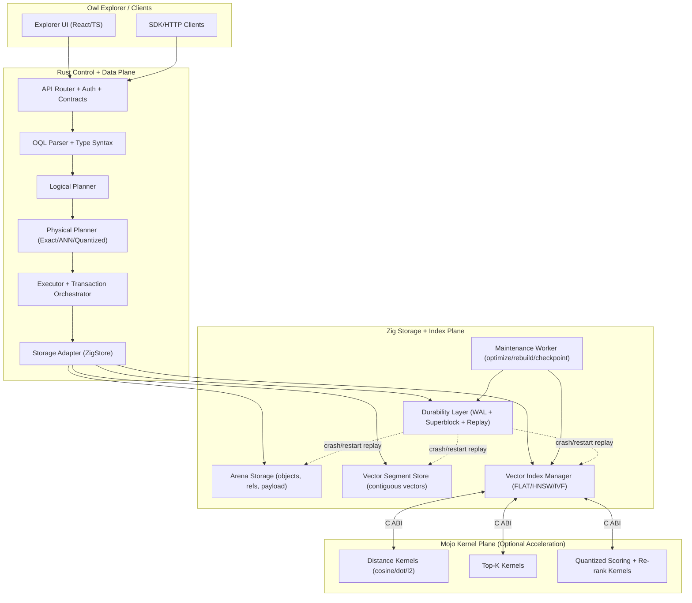

# Owl Vector DB Implementation Blueprint

## 1) Purpose
Build production-grade vector capabilities in Owl while preserving Owl's architecture:

- Zig owns low-level storage/index/durability mechanics.
- Mojo owns optional ultra-fast compute kernels (distance, top-k, quantized scoring).
- Rust owns OQL semantics, planning, orchestration, and API contracts.

This document is the implementation plan and quality bar before code changes.

## 2) What Was Studied

### Milvus (architecture + operations discipline)
- `vector_db/milvus-master/README.md`
- `vector_db/milvus-master/docs/developer_guides/chap01_system_overview.md`
- `vector_db/milvus-master/docs/developer_guides/chap03_index_service.md`
- `vector_db/milvus-master/docs/developer_guides/chap07_query_coordinator.md`
- `vector_db/milvus-master/docs/developer_guides/chap09_data_coord.md`
- `vector_db/milvus-master/internal/streamingnode/server/wal/README.md`
- `vector_db/milvus-master/internal/datacoord/README.md`
- `vector_db/milvus-master/internal/datanode/README.md`

### Qdrant (collection-centric vector DB internals)
- `vector_db/qdrant-master/README.md`
- `vector_db/qdrant-master/lib/collection/README.md`
- `vector_db/qdrant-master/lib/collection/docs/collection-struct.mmd`
- `vector_db/qdrant-master/lib/collection/docs/update-sequence.mmd`
- `vector_db/qdrant-master/lib/collection/src/collection/mod.rs`
- `vector_db/qdrant-master/lib/collection/src/update_handler.rs`
- `vector_db/qdrant-master/docs/roadmap/README.md`

### MongoDB Search / mongot (ingestion, replication, quantization)
- `vector_db/mongot-main/README.md`
- `vector_db/mongot-main/src/main/java/com/xgen/mongot/index/lucene/README.md`
- `vector_db/mongot-main/src/main/java/com/xgen/mongot/index/lucene/quantization/README.md`
- `vector_db/mongot-main/src/main/java/com/xgen/mongot/index/ingestion/README.md`
- `vector_db/mongot-main/src/main/java/com/xgen/mongot/index/ingestion/handlers/README.md`
- `vector_db/mongot-main/src/main/java/com/xgen/mongot/replication/mongodb/initialsync/README.md`
- `vector_db/mongot-main/src/main/java/com/xgen/mongot/replication/mongodb/steadystate/README.md`
- `vector_db/mongot-main/src/main/java/com/xgen/mongot/replication/mongodb/steadystate/changestream/README.md`

### Zvec (in-process high-performance vector engine)
- `vector_db/zvec-main/README.md`
- `vector_db/zvec-main/tools/core/README.md`
- `vector_db/zvec-main/src` layout (core/algorithm, quantizer, metric, db/index)

### Owl current architecture (fit analysis)
- `src/lib.rs`
- `src/storage.rs`
- `src/planner/logical.rs`
- `src/planner/physical.rs`
- `src/parser.rs`
- `src/type_syntax.rs`
- `docs/storage_layer_contract.md`
- `owl_storage_zig/include/owl_storage.h`
- `owl_storage_zig/src/c_api.zig`
- `owl_storage_zig/rust_bindings/src/ffi.rs`

## 3) What We Will Adopt (and Why)

## 3.1 From Milvus
Adopt:
- Strong lifecycle separation: ingest/logging, indexing, query serving.
- Interface-first index service semantics (build async, observe state, fetch artifacts).
- Stream/WAL-first write discipline and recoverable state transitions.

Do not adopt:
- Full distributed coordinator complexity now.

Owl adaptation:
- Keep single-node core.
- Add explicit vector index lifecycle in Zig with async build state persisted in WAL/superblock metadata.

## 3.2 From Qdrant
Adopt:
- Collection as strict vector schema boundary (dimension + payload invariants).
- Update pipeline shape: WAL append -> updater -> optimizer/index maintenance.
- Segment/index optimization as background tasks with bounded resource budgets.

Do not adopt:
- Full shard/replica subsystem immediately.

Owl adaptation:
- Per-collection vector index metadata + segmented physical layout in Zig.
- Background optimize/rebuild worker in Rust control plane, executed by Zig services.

## 3.3 From mongot
Adopt:
- Stateless ingestion/transformation pipeline design.
- Initial-sync + steady-state update model for rebuild and resumability.
- Quantized candidate scoring + full-fidelity re-score.

Do not adopt:
- Direct code reuse (SSPL-licensed project). We adopt ideas only.

Owl adaptation:
- Build resumable vector index rebuild checkpoints.
- Implement two-stage search path:
  - approximate/quantized candidate generation
  - exact re-rank for top results

## 3.4 From Zvec
Adopt:
- In-process model for low-latency local deployments.
- Algorithm portfolio mindset (flat, HNSW, IVF, sparse-hybrid options).
- Strong benchmarking culture with reproducible configs.

Do not adopt:
- Full SQL layer or direct reimplementation of entire framework.

Owl adaptation:
- Keep OQL as primary language.
- Add vector ops to OQL and planner with algorithm backend selection.

## 4) Non-Negotiable Quality Rules

- No semantic duplication across layers:
  - Zig/Mojo must not own OQL semantics.
  - Rust must not reimplement allocator/page/index internals meant for Zig.
- No silent correctness regressions:
  - vector index updates must be transaction-coupled to document updates.
- No ambiguous ownership:
  - every function belongs clearly to Zig, Mojo, or Rust.
- No hidden fallback behavior:
  - planner must expose whether query used exact scan, ANN, quantized ANN+rerank.
- No production rollout without measured gates:
  - latency, recall, durability, crash-recovery tests must pass first.

## 5) Layer Boundaries

## 5.1 Zig/Mojo Boundary (Low-level)

Zig responsibilities:
- Vector storage layout and lifecycle:
  - allocate, write, delete, compact
  - segment metadata and vector index metadata
- Vector index graph/data structures:
  - FLAT baseline
  - HNSW (phase 2)
  - IVF optional (phase 3)
- WAL-coupled mutation records and replay hooks.
- Durable rebuild checkpoints and index state transitions.
- Calls Mojo kernels through a narrow C ABI.

Mojo responsibilities:
- Pure compute kernels only:
  - batch distance (`cosine`, `dot`, `l2`)
  - top-k selection/heap selection
  - optional quantized distance kernels
  - optional full-fidelity rerank kernel
- No index ownership, no WAL ownership, no persistence.
- Deterministic function contracts with explicit error codes.

ABI contract principle:
- Zig calls Mojo through versioned C ABI.
- All buffers are caller-owned.
- No heap ownership crossing ABI boundary.

Proposed ABI sketch:
```c
// versioned kernel ABI
int owl_mojo_cosine_batch_f32(
  const float* corpus,    // [n * dim]
  const float* query,     // [dim]
  uint32_t n,
  uint32_t dim,
  float* out_scores       // [n]
);

int owl_mojo_topk_f32(
  const float* scores,    // [n]
  uint32_t n,
  uint32_t k,
  uint32_t* out_idx,      // [k]
  float* out_scores       // [k]
);
```

## 5.2 Rust Data Plane Boundary (High-level)

Rust responsibilities:
- OQL syntax + AST + semantics:
  - `Vector(dim)` type syntax parsing
  - vector query operators (e.g. `nearest`)
- Logical/physical planning:
  - choose exact vs ANN vs quantized ANN+rerank
  - expose explain data
- Query execution orchestration:
  - parameter validation
  - call into storage adapter and interpret results
- Transaction orchestration and API contracts.
- Explorer/API payload validation and user-visible errors.

Rust must call storage abstractions, not inline low-level vector kernels directly.

## 6) Owl Vector Feature Scope

## 6.1 OQL and Schema
Add:
- `Vector(<dim>)` field type.
- `nearest` operation (planner-visible, not ad-hoc function only).

Example syntax:
```oql
products.nearest {
  field: .embedding,
  query: [0.12, -0.03, ...],
  metric: "cosine",
  k: 20
}.where { .status == "active" }
 .select { id, title, score: ._score }
 .sort { ._score.desc }
 .limit(20)
```

## 6.2 Storage + Index
Per collection vector config:
- field name
- dimension
- metric
- index type
- quantization mode (none/scalar/binary)

Index lifecycle states:
- `Creating`, `Ready`, `Rebuilding`, `Degraded`, `Failed`

## 6.3 API + Explorer
Add endpoints:
- create/update vector index
- rebuild/resume rebuild
- explain vector plan
- vector search diagnostic stats

Explorer:
- vector field picker in schema UI
- nearest-query helper
- index health and rebuild actions

## 7) Implementation Plan (Phased)

## Phase V0: Correctness Baseline (Exact)
Deliver:
- `Vector(dim)` type and value coercion.
- Exact vector scan in Zig (SIMD-capable path).
- Rust physical operator `VectorKnnScanExact`.
- OQL `nearest` syntax + execution.

Acceptance:
- exact results identical to NumPy/ground-truth baseline.
- crash/restart retains vectors and metadata.

## Phase V1: ANN Core (HNSW in Zig)
Deliver:
- HNSW index build/search/update/delete in Zig.
- WAL-coupled vector index mutations.
- planner chooses ANN path when index ready.

Acceptance:
- target recall@10 threshold with benchmark datasets.
- update + query concurrency correctness tests pass.

## Phase V2: Quantized Search + Re-rank
Deliver:
- scalar quantization first, binary next.
- candidate generation over quantized vectors.
- exact rerank on top candidates.
- optional Mojo kernels for quantized scoring and rerank.

Acceptance:
- memory reduction target met.
- recall drop within configured tolerance.

## Phase V3: Optimizer + Maintenance
Deliver:
- background optimize/rebuild with resumable checkpoints.
- index state machine with clear progress and failure reasons.
- online rebuild with read availability.

Acceptance:
- rebuild survives interruptions and resumes correctly.
- no query downtime for common rebuild flows.

## 8) File-Level Change Map (Owl)

Rust (language/planner/executor):
- `src/schema.rs` -> add `FieldType::Vector { dim: u32 }`
- `src/type_syntax.rs` -> parse `Vector(dim)`
- `src/parser.rs` -> add `nearest` operation AST + parser rules
- `src/planner/types.rs` -> vector plan metadata and operator params
- `src/planner/logical.rs` -> logical node for nearest
- `src/planner/physical.rs` -> choose exact/ANN/quantized physical operators
- `src/execution/*` -> add vector execution operators
- `src/executor.rs` -> integrate vector operations in execution flow
- `src/storage.rs` -> high-level vector storage adapter hooks
- `src/bin/owl-explorer/api/*` -> vector index/query endpoints + explain

Zig storage engine:
- `owl_storage_zig/src/*` -> vector segment/index modules + lifecycle
- `owl_storage_zig/src/c_api.zig` -> vector index C ABI exports
- `owl_storage_zig/include/owl_storage.h` -> vector index API declarations
- `owl_storage_zig/rust_bindings/src/ffi.rs` -> bind new C APIs

Mojo kernels (new module):
- `mojo_kernels/` (new) -> distance/topk/quantized kernels
- `mojo_kernels/include/owl_mojo_kernels.h` -> stable ABI
- CI build artifact consumed by Zig runtime

## 9) Durability and Transaction Semantics

Write path rule (strict):
1. Validate vector dimensions/types in Rust.
2. Emit WAL mutation record (vector op + doc op linkage).
3. Apply Zig index/data mutation.
4. Mark committed in transaction context.

Recovery rule:
- Replay committed records only.
- If index state inconsistent, mark `Degraded` and trigger resumable rebuild.

Rollback rule:
- no partial visibility of vector/document mismatch.

## 10) Performance Strategy (Why This Will Be Fast)

1. Data locality:
- vectors stored contiguously in Zig segments, aligned for SIMD/cache.

2. Narrow ABI overhead:
- Rust dispatches coarse operations; no per-element FFI calls.

3. Compute specialization:
- Mojo kernels accelerate dense math hotspots only.

4. Planner intelligence:
- vector index path selected only when beneficial.
- exact scan fallback prevents tail-risk correctness issues.

5. Two-stage retrieval:
- quantized candidate pass + exact rerank gives strong recall/latency tradeoff.

6. Background maintenance:
- async optimize/rebuild avoids foreground stalls.

## 11) Benchmark and Quality Gates

Datasets:
- synthetic controlled sets
- public ANN benchmark datasets
- Owl workload-shaped mixed payload + vector data

Metrics:
- p50/p95/p99 query latency
- QPS under mixed read/write
- recall@k and NDCG
- index build throughput
- memory footprint and disk footprint
- restart recovery time

Hard gates before production flag:
- no durability invariants broken in fault-injection tests
- recall/latency targets met for declared SLA profile
- zero panics in long-run stress tests

## 12) Legal/Reuse Policy

- Qdrant/Milvus/Zvec are Apache-2.0: we can study and re-implement patterns safely.
- Mongot is SSPL: treat as design inspiration only; do not copy code.
- Keep an internal "influence log" for traceability of design decisions.

## 13) Detailed Architecture Diagram



## 14) Decision Summary

This approach gives Owl:
- Production-grade vector capabilities without architectural drift.
- High performance from Zig locality + optional Mojo math acceleration.
- Durable, recoverable behavior consistent with Owl storage contracts.
- Clean evolution path from exact search to ANN to quantized ANN+rerank.

Implementation starts only after sign-off on this blueprint.

